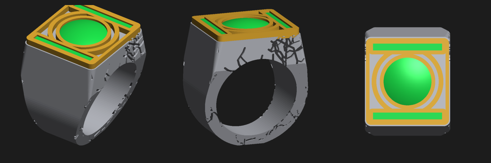

# Lantern power ring (fan prop)

> **Folder layout:** this `final/` folder is the 3-colour AMS version. The one-piece ring for painting is in [`../single-colour/`](../single-colour/). If you re-run the generator it writes the single-colour file into `stl/us10/` here; move it across afterwards.

A chunky signet ring inspired by the ring in the *Lanterns* TV show: a cracked-stone
silver band, a gold-framed face, and green inlays with a domed centre gem.
This is my own model, not a copy of the official prop.



Made for **US size 10 (middle finger)**, printed on a **Bambu Lab P1S with AMS**.

## Files

| File | What it is |
|---|---|
| `stl/us10/ring_us10_body.stl` | Band and head (silver / grey) |
| `stl/us10/ring_us10_frame.stl` | Raised emblem outline (gold) |
| `stl/us10/ring_us10_inlay.stl` | Bar inlays and domed gem (green) |
| `../single-colour/ring_us10_single_colour.stl` | Whole ring as one piece, if you'd rather paint it |
| `stl/size-test/size_test_us9_5/10/10_5.stl` | Thin 3 mm test bands to check fit first |
| `generator/build.py` | Script that builds every STL (change the size here) |
| `generator/render.py` | Makes `preview.png` |

Size: about 20 mm across the face, 27 mm tall. The hole is 19.91 mm
(US 10 = 19.76 mm, plus 0.15 mm because printed holes come out slightly small).

## 1. Check the fit first (5 minutes)

Print the three size-test bands in any colour. Wear the one that fits best.
If it's US 10, use the files as they are. If not, rebuild for the right size (see below).

## 2. Load it in Bambu Studio as one multi-colour object

1. Drag **all three** files (`body`, `frame`, `inlay`) into Bambu Studio at the same time.
2. When it asks *"Load these files as a single object with multiple parts?"*, click **Yes**.
   The parts are already lined up.
3. In the object list, set the filament for each part:
   - body: silver or grey PLA (silk silver looks best)
   - frame: gold PLA (silk gold looks best)
   - inlay: translucent green PETG/PLA, or **glow-in-the-dark green** so it glows at night
4. Leave the ring face up, exactly as it loads.

## 3. Print settings

| Setting | Value |
|---|---|
| Layer height | 0.08 mm (0.12 mm is fine too) |
| Walls | 4 |
| Infill | 100% (it's small, and this makes it strong) |
| Supports | On, **tree (auto)**, so the inside of the finger hole is supported |
| Support interface | On, ideally with Bambu support filament or PETG for an easy break-off |
| Brim | Small brim (3 mm), since the ring stands on a narrow flat strip |
| Prime tower | On (Bambu default) |

Print time is roughly 1.5 to 2.5 hours, mostly from colour changes.

## 4. Finishing

- Pull the supports from inside the hole and sand it smooth with 400 grit,
  so it's comfortable to wear.
- Optional: rub black acrylic paint into the cracks on the band and wipe the
  surface off. The cracks stay dark and the "stone" look pops.
- Optional: a coat of gloss varnish on the green gem makes it look like glass.

## Change the size

```bash
pip install manifold3d trimesh numpy
python3 generator/build.py --us-size 10.5        # new folder stl/us10_5/
python3 generator/build.py --clearance 0.25      # roomier hole
```
