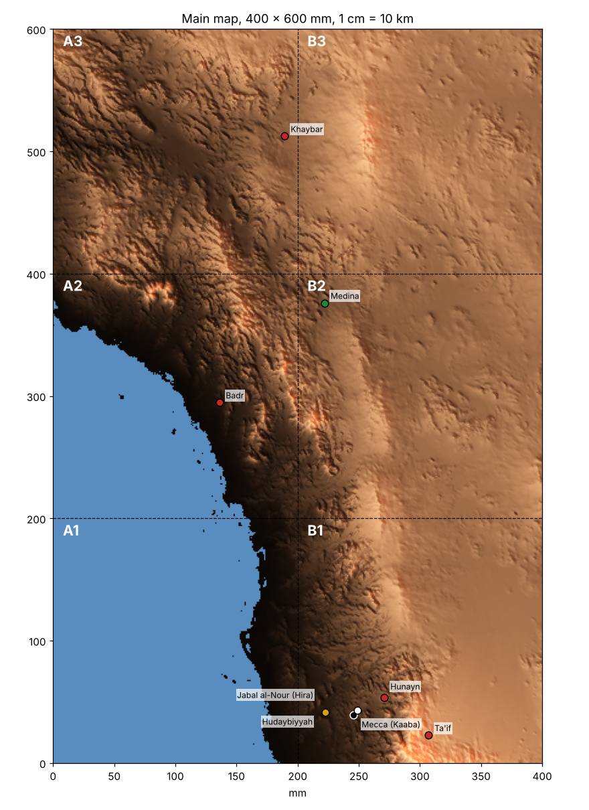
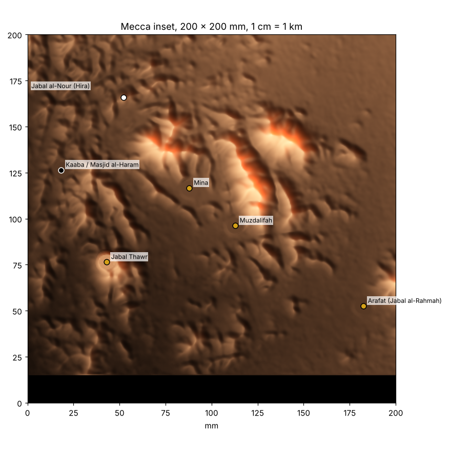
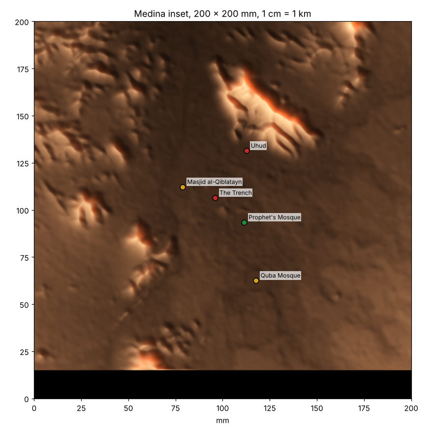
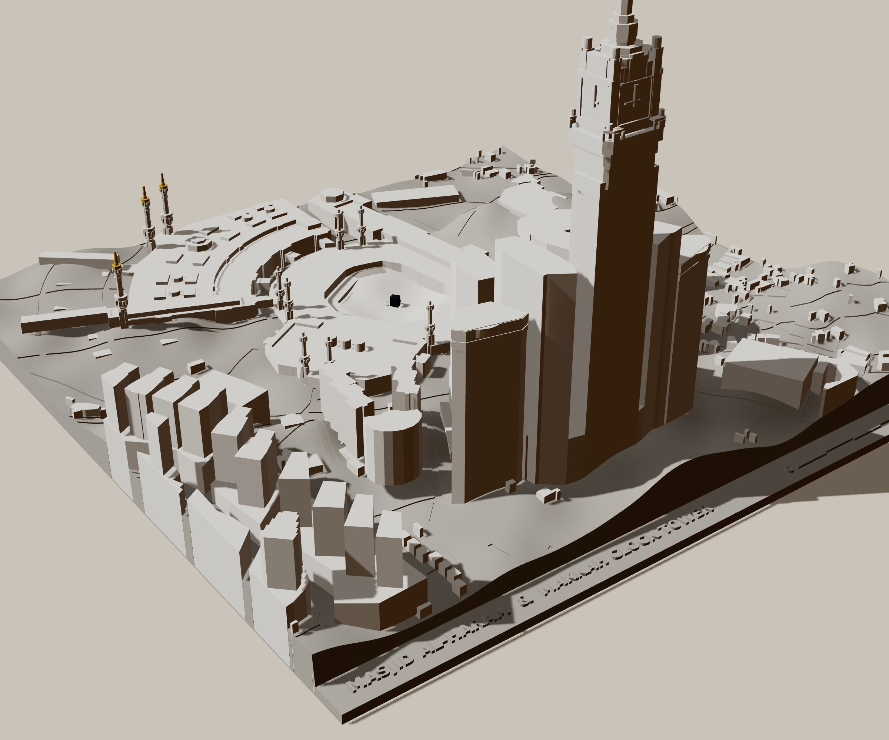
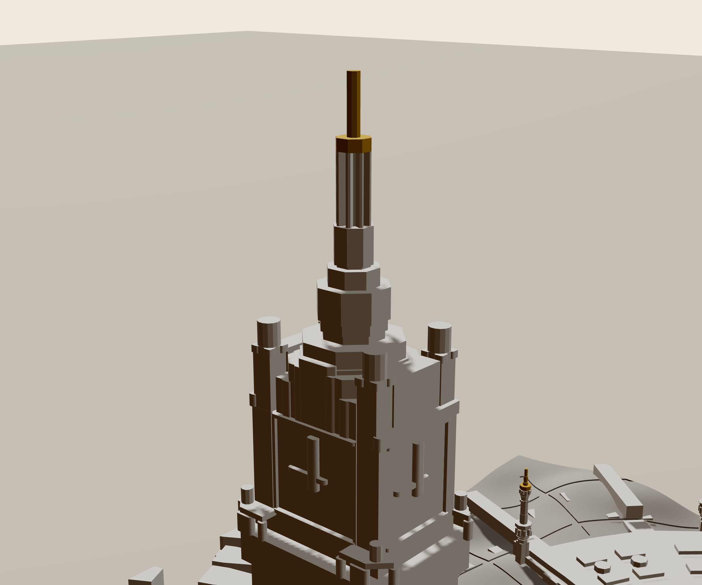
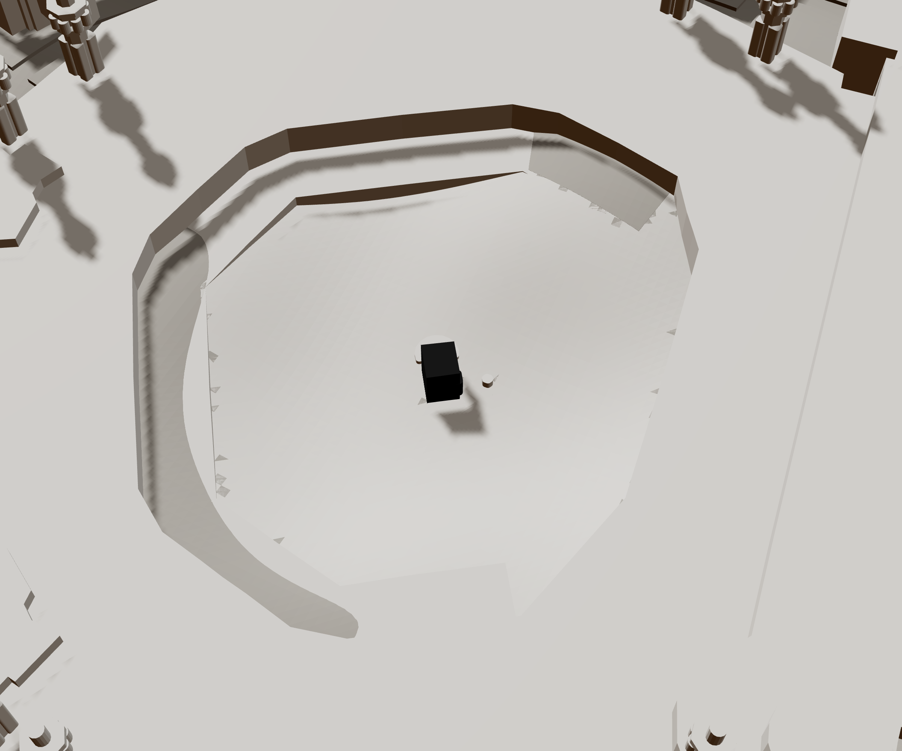

# Map of the Hijaz in the time of the Prophet ﷺ

> **Folder layout:** this `final/` folder is the multicolour version for the Bambu P1S + AMS (`ams/`), plus the keys and legend plaque in `stl/`. The single-colour tiles and peg-on markers are in [`../single-colour-with-pegs/`](../single-colour-with-pegs/). If you re-run the generator it writes every STL into `stl/` here; move the single-colour ones across afterwards. The Haram and Clock Tower model is in [`../haram-clock-tower-model/`](../haram-clock-tower-model/).

A 3D-printable relief map of western Saudi Arabia, from Ta'if and Mecca in the
south to Khaybar in the north, built from real elevation data and printed in
tiles that join into one map. It marks Mecca, Medina, Jabal al-Nour (Cave of
Hira), and the main battles and events of the Prophet's life.



| Mecca inset | Medina inset |
|---|---|
|  |  |

## What you get

| Piece | Size | Count | Colour |
|---|---|---|---|
| Main map tiles `../single-colour-with-pegs/main_A1 … main_B3.stl` | 200 × 200 mm each, 400 × 600 mm assembled | 6 | Brown |
| Mecca inset `../single-colour-with-pegs/inset_mecca.stl` | 200 × 200 mm | 1 | Brown |
| Medina inset `../single-colour-with-pegs/inset_medina.stl` | 200 × 200 mm | 1 | Brown |
| Legend plaque `stl/legend_plaque.stl` (title, key, scale bars) | 200 × 150 mm | 1 | Brown (or any) |
| Joining keys `stl/joining_keys.stl` (bow-ties) | 30 × 14 mm | 14 + 2 spare | Brown |
| Kaaba markers `../single-colour-with-pegs/markers_black_kaaba.stl` | cube | 2 + 1 spare | **Black** |
| Hira markers `../single-colour-with-pegs/markers_white_light.stl` (peak cone for the main map + the summit cap for the Mecca inset) | | 1 + cap + 1 spare | **White** |
| Prophet's Mosque markers `../single-colour-with-pegs/markers_green_mosque.stl` | dome | 2 + 1 spare | **Green** |
| Battle markers `../single-colour-with-pegs/markers_red_battle.stl` | spire | 6 + 1 spare | **Red** |
| Other events `../single-colour-with-pegs/markers_gold_site.stl` | hexagon | 7 + 1 spare | **Gold / yellow** |

Tile names: columns **A** (west, Red Sea side) and **B** (east); rows **1**
(south, Mecca) to **3** (north, Khaybar). Each tile's name is engraved on its
underside along with an arrow showing which edge is north.

```
 +----+----+
 | A3 | B3 |   Khaybar
 +----+----+
 | A2 | B2 |   Badr, Medina
 +----+----+
 | A1 | B1 |   Red Sea, Mecca, Ta'if
 +----+----+
```

## Scale: how to measure on the map

**Main map: 1 cm = 10 km (1:1,000,000). 1 mm = 1 km, 1 inch = 25.4 km (about 15.8 miles).**

Use a ruler in centimetres: read the distance and multiply by 10 to get
kilometres. Examples, straight-line distances checked against the true
distances on the globe:

| From → to | On the map | Real distance |
|---|---|---|
| Mecca → Medina | 33.8 cm | 338 km |
| Medina → Khaybar | 14.0 cm | 140 km |
| Medina → Badr | 11.8 cm | 118 km |
| Mecca → Ta'if | 6.3 cm | 63 km |
| Mecca → Hudaybiyyah | 2.3 cm | 23 km |
| Kaaba → Jabal al-Nour | 0.5 cm | 5.2 km |

The map uses the UTM zone 37N grid, so the scale is true to within 0.05%
everywhere on it; the error you'll see comes from the printer, not the map.
"North" on the tiles is grid north, which is within 1° of true north here.
A printed 100 km scale bar is raised on the Red Sea in tile A1, and both
scale bars are on the legend plaque.

**Distance rings from the Kaaba.** Thin grooves circle Mecca every 50 km
across the whole main map, each labelled ("100 km", "150 km" …) in raised
text. Put your finger on any mountain, follow it to the nearest ring, and you
can read how far it is from Mecca without a ruler. Medina sits just inside the
350 km ring (338 km), Badr between the 250 and 300 rings (278 km), Khaybar
just inside 500 (476 km). Set `RING_KM = []` in
`build.py` to print the map without them.

**Insets: 1 cm = 1 km (1:100,000).** Mecca and Medina get their own tiles at
ten times the detail, because at the main scale Uhud and the Trench sit within
a few millimetres of the Prophet's Mosque. Each inset has a 5 km scale bar on
its label strip. The Mecca inset covers 20 × 18.5 km (Haram to Arafat), and
the Medina inset the same area around the city.

**Heights are exaggerated** so the mountains read clearly:

* main map: 1 mm of height = 100 m (10× exaggeration). Sea level is 4 mm above
  the bottom of the tile; the sea itself sits 0.6 mm lower.
* insets: 1 mm of height = 40 m (2.5× exaggeration), measured from a base
  level of 200 m (Mecca) or 550 m (Medina), which is 4.6 mm above the bottom.

## Colour plan

Everything you print for the land is **brown**. Colour comes from the small
markers that press onto pegs on the tiles, so it works on any single-colour
printer with no filament changes.

| Colour | Marker | Where |
|---|---|---|
| **Black** | Cube, turned so its corners face the compass points like the real Kaaba | Mecca (main map and inset) |
| **White** | Cone on the main map; on the Mecca inset the **top 150 m of Jabal al-Nour itself** is a separate white cap, so the peak where the first revelation came glows white | Jabal al-Nour, Cave of Hira |
| **Green** | Dome | Medina / the Prophet's Mosque |
| **Red** | Spire | Badr, Uhud, the Trench, Khaybar, Hunayn, Ta'if |
| **Gold** | Hexagon | Hudaybiyyah, Cave of Thawr, Quba, Qiblatayn, Mina, Muzdalifah, Arafat |

**Sand-sculpture look:** print every brown piece in a sand, tan or beige PLA
instead and the map reads like a model shaped out of desert sand, with the
coloured markers standing out even more. Nothing else changes.

Optional extras: paint the Red Sea blue (it is a flat, recessed surface with a
crisp coastline, easy to mask), and run a red paint pen along the engraved
groove of the Trench on the Medina inset.

## Sites on the map

| Marker | Place | Event |
|---|---|---|
| Black | Mecca, the Kaaba | Birth of the Prophet c. 570 CE; Conquest of Mecca, 8 AH / 630 CE |
| White | Jabal al-Nour, Cave of Hira | First revelation, 610 CE |
| Gold | Jabal Thawr *(inset)* | Cave of Thawr, start of the Hijra, 622 CE |
| Green | Medina, the Prophet's Mosque | The Hijra, 1 AH / 622 CE |
| Gold | Quba Mosque *(inset)* | First mosque, 1 AH / 622 CE |
| Gold | Masjid al-Qiblatayn *(inset)* | Change of the qibla, 2 AH / 624 CE |
| Red | Badr | Battle of Badr, 2 AH / 624 CE |
| Red | Uhud *(inset, archers' hill)* | Battle of Uhud, 3 AH / 625 CE |
| Red | The Trench *(inset, marker + engraved groove)* | Battle of the Trench, 5 AH / 627 CE |
| Gold | Hudaybiyyah | Treaty of Hudaybiyyah, 6 AH / 628 CE |
| Red | Khaybar | Battle of Khaybar, 7 AH / 628 CE |
| Red | Hunayn | Battle of Hunayn, 8 AH / 630 CE |
| Red | Ta'if | Siege of Ta'if, 8 AH / 630 CE |
| Gold | Mina, Muzdalifah *(inset)* | Hajj sites |
| Gold | Arafat, Jabal al-Rahmah *(inset)* | Farewell Sermon, 10 AH / 632 CE |

Two locations are approximate and say so in `generator/sites.py`: the valley
of Hunayn (its exact battlefield is debated) and the line of the Trench (drawn
across the open north side of Medina between the two lava fields, near Jabal
Sal'). Tabuk and Mu'tah are too far north to fit on this map.

## Masjid al-Haram and the Makkah Clock Tower (architectural model)



| Clock Tower | Mataf and the Kaaba |
|---|---|
|  |  |

A detailed city model of the area around the Kaaba: one 240 × 240 mm tile at
**1:4,000 (1 cm = 40 m)** with **true heights, no exaggeration**, so the Clock
Tower stands 150 mm tall (601 m) and the minarets about 34 mm.

* Every building is extruded from its real footprint and height, including the
  stepped shape of the Clock Tower, its clock section and spire, the Abraj
  al-Bait towers, the Haram with its minarets, the mataf ring, the Kaaba, the
  Maqam Ibrahim and the Hijr Ismail wall.
* The ground follows the real terrain of the valley, and streets are engraved
  into it.
* A raised title and a 200 m scale bar sit on the strip along the south edge;
  the bottom is engraved with the name and scale.

Files:

* `../haram-clock-tower-model/haram_model.3mf`: colour version for the AMS. Slot 1 **light grey**
  (ground), 2 **white** (buildings and the marble floor of the mataf),
  3 **black** (the Kaaba), 4 **gold** (the crescent on the Clock Tower and the
  minaret tips). Per-colour STLs are in `../haram-clock-tower-model/ams-parts/` as a fallback.
* `../haram-clock-tower-model/haram_model_one_piece.stl`: the same model in one piece for a single colour (white
  or light grey PLA looks like the photo reference).

Printing tips: 0.12–0.16 mm layers for the fine detail, 3 walls, 10% infill,
turn on **tree supports (auto)** for the few bridges between buildings, and
print the tall tower slowly (Bambu Studio "Silent" mode or 50% speed for the
top 60 mm) so the thin spire stays crisp. Expect a long print (likely more than
a day).

The buildings come from Overture Maps, which includes OpenStreetMap data
(© OpenStreetMap contributors, ODbL). `generator/fetch_haram_data.py`
refreshes the saved data in `generator/data/`, and `generator/haram.py`
rebuilds the model (change `SCALE`, `CENTER` or `W` to make it bigger,
smaller, or centred somewhere else).

## Printing in colour on a Bambu P1S with AMS (recommended)

The `ams/` folder has a multicolour version of every tile, so the colours
print straight into the map: no pegs, no painting, no gluing.

* the **Red Sea** prints **blue** (its top 0.6 mm), with the scale bar, north
  arrow and "RED SEA" standing out in brown
* the markers are printed **on** the tiles in colour: black Kaaba, white Hira
  cone, green dome for Medina, red spires for battles, gold hexagons
* on the Mecca close-up, the **top 150 m of Jabal al-Nour prints white**
* on the Medina close-up, the **Trench** groove is filled **red**

Each tile uses at most 4 colours, so it fits one AMS. Brown is always slot 1:

| Tile | Slot 1 | Slot 2 | Slot 3 | Slot 4 |
|---|---|---|---|---|
| `main_A1.3mf` | brown | blue | | |
| `main_A2.3mf` | brown | blue | red | |
| `main_A3.3mf` | brown | red | | |
| `main_B1.3mf` | brown | white | black | red |
| `main_B2.3mf` | brown | green | | |
| `main_B3.3mf` | brown | | | |
| `inset_mecca.3mf` | brown | white | black | gold |
| `inset_medina.3mf` | brown | red | green | gold |
| `haram_model.3mf` | light grey | white | black | gold |

A sensible AMS load is **brown, blue, white, black**, then swap blue for red,
green or gold for the tiles that need them. On tile B1 the Hudaybiyyah marker
prints **white** instead of gold (the treaty was a peace), which keeps B1 at 4
colours.

How to print one tile:

1. Open the `.3mf` in Bambu Studio. It loads as one object with one part per
   colour, already set to filaments 1–4 in the order above.
2. In the filament list on the left, set each filament to the matching AMS
   slot and colour (or click the AMS sync button).
3. Slice and print. Use 0.2 mm layers; the colour parts are small, so the
   purge waste is modest. Set "Flush into objects' infill" to save filament.

If the colours don't come through (older slicer versions can ignore the part
settings in a 3MF), use the STL parts instead: select **all** the files in
`ams/stl/<tile>/` at once, drag them into Bambu Studio, and answer **Yes** to
"Load these files as a single object with multiple parts?". The number in each
file name is its filament slot, and the colour is in the name.

The keys, the legend plaque and the joining instructions are the same as the
single-colour version below. The peg markers in `../single-colour-with-pegs/` are only needed for a
single-colour printer.

## Printing

The tiles are 200 × 200 mm so they fit a 220 × 220 mm bed with room for a
skirt, and the P1S's 256 × 256 mm bed easily.

Suggested settings (PLA):

* Layer height 0.2 mm (0.12–0.16 mm for the insets and markers if you want
  smoother contours)
* 3 walls, 3 top layers, 10–15% gyroid infill for the tiles
* No supports needed for anything. Print every piece the way it is in the file
  (flat side down).
* Brim off for the tiles; a small brim helps the tiny markers stick.
* Markers: 100% infill, slow (20–30 mm/s), 0.12 mm layers. Print one marker
  file at a time in its colour.

Rough material: the six main tiles are about 1 kg of brown at 15% infill;
each inset about 150 g. Expect roughly 6–10 hours per tile at 0.2 mm,
depending on the printer.

The tallest piece is tile B1 at 28 mm (the mountains around Ta'if).

## Assembly

1. Lay the six main tiles face down, arranged as in the diagram above but
   mirrored (A on the right when face down). The engraved names on the
   underside read correctly from this side.
2. Press a bow-tie key into each pair of matching pockets across every seam
   (14 keys). They are a snug fit; add a drop of CA glue or wood glue in each
   pocket if you want the map permanent. The keys pull the tiles tight and
   line them up.
3. Turn the map over. Push each marker onto its peg (match the colours to the
   table above). A dot of glue makes them permanent.
4. Mecca inset: put a drop of glue on the small nub on top of Jabal al-Nour
   and press the white summit cap onto it.
5. The insets and the legend plaque stand alone; display them beside the main
   map, for example below tiles A1 and B1.

If a key or a peg is too tight for your printer, change `KEY_CLEAR` or
`SOCKET_R` in `generator/build.py` and re-run it.

## Regenerating or changing the design

Everything is generated by `generator/build.py` from real elevation data, so
you can change the scale, bed size, exaggeration, tile layout or the list of
sites and rebuild:

```bash
cd generator
pip install -r requirements.txt
python build.py
```

The first run downloads about 135 small elevation tiles (a few MB) (cached in
`generator/.cache/`). Key settings at the top of `build.py`:

* `TILE` – tile edge in mm (raise it for a bigger bed)
* `MAIN_KM_PER_MM` – map scale (1.0 means 1 mm = 1 km)
* `MAIN_M_PER_MM_Z`, `INSET_M_PER_MM_Z` – vertical exaggeration
* `MAIN_E0`, `MAIN_N0`, `MAIN_COLS`, `MAIN_ROWS` – which area the map covers
* Sites, dates and marker colours live in `generator/sites.py`.

## Data and accuracy

* Elevation: Terrarium terrain tiles from the AWS Open Data "Terrain Tiles"
  set (Mapzen), which combine NASA SRTM, USGS GMTED2010 and ETOPO1. Main map
  sampled at about 300 m, insets at about 20 m. Very sharp peaks come out a
  few tens of metres lower than their true height.
* Site coordinates: WGS84, mostly accurate to within a few hundred metres,
  which is under half a millimetre on the main map.
* Projection: UTM zone 37N (EPSG:32637).

## Interactive 3D viewer

`viewer/index.html` is a 3D version of the whole map and both close-ups that
runs in any browser. Tap any mountain, valley or marker to see how far it is
from the Kaaba (km, miles, and cm/inches on the print), its height and
position. It has a **Measure** mode for any two points, the same 50 km
distance rings as the print, a **Sand** look, and a height slider. Open the
file locally, or use the hosted copy.

Renders of the printed result are in `preview/` (`printed-map-*.png`,
`mecca-*.png`, `medina-*.png`).
