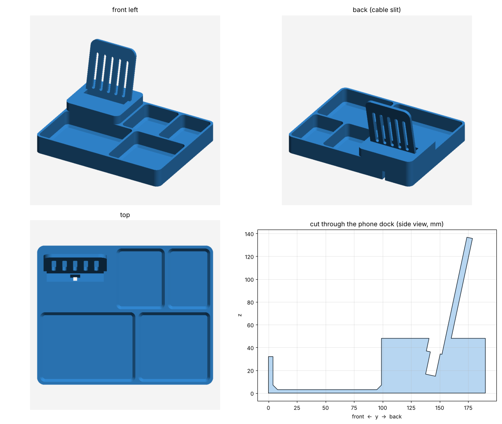

# Nightstand valet tray with phone dock

An open-top tray for the nightstand. At night you drop everything in it,
and in the morning you grab it all and go. It has:

| Spot | Inside size (mm), 29 mm deep | For |
|---|---|---|
| Phone dock | slot 78 x 14, phone leans back 12° | Phone charging on a USB-C cable |
| Earbuds | 66 x 83 | Earbuds case |
| Watch | 58 x 83 | Watch |
| Wallet | 130 x 95 | Wallet (a bifold is about 115 x 90) |
| Keys | 94 x 95 | Keys, rings, loose change |

Outside size: **240 x 190 mm footprint, 32 mm tall walls, 137 mm to the top
of the phone backrest** (24.0 x 19.0 cm, about 9.4 x 7.5 in). It fits the
256 x 256 mm bed of the Bambu Lab P1S in one piece.



## How the phone dock works

1. Feed the USB-C end of your charging cable down through the phone slot,
   so the plug drops into the pocket under the slot floor. The metal tip
   sticks up about 6 mm.
2. Press the cable into the thin slit under the pocket. It comes out at the
   back of the dock.
3. Lower the phone onto the plug. It rests on its bottom edge, leaning back
   on the backrest.

**Heat:** the phone stands upright in open air, and the backrest has five
vent slots right behind it, so the back of the phone (where it warms up
while charging) is not pressed against solid plastic. Print in PETG if you
can: it softens at about 80 °C, while PLA softens at about 60 °C.

## Files

- `stl/nightstand_valet.stl`: the full tray, one piece.
- `stl/dock_fit_test.stl`: just the phone dock. Print it first to check that
  your phone and cable fit before starting the big print.
- `generator/build.py`: makes both STLs. Every size is a number at the top.
- `generator/render.py`: makes `preview.png`.

## Fitting your phone and cable

The defaults assume an OPPO Find N-series foldable, folded, in a slim case:
**76 mm wide and 12 mm thick** with the case on, and a USB-C plug body of
13 x 8 x 20 mm. Measure yours and change these lines in `generator/build.py`:

```python
PHONE_W = 76.0      # width of the phone + case
PHONE_T = 12.0      # thickness of the folded phone + case
PLUG_W = 13.0       # plug body width
PLUG_T = 8.0        # plug body thickness
PLUG_LEN = 20.0     # plug body length, without the metal tip
```

Then rebuild:

```bash
pip install manifold3d numpy trimesh matplotlib scipy
cd generator
python3 build.py    # writes the STLs
python3 render.py   # optional: refreshes preview.png
```

If the plug sits too low and the phone doesn't connect, make `PLUG_LEN`
smaller. If it sits too high, make it bigger.

## Printing (Bambu Lab P1S)

- Filament: PETG recommended (PLA works too). One colour.
- Orientation: as exported, flat on the bed. **No supports needed.**
- Layer height 0.2 mm, 3 walls, 15% gyroid infill.
- Brim: helps with PETG on a print this big. Optional for PLA.
- Optional: four 10 mm stick-on rubber bumpers go in the shallow round
  recesses on the underside, so the tray doesn't slide.

## Not included

A hat won't fit in a tray this size. Set it on top of the wallet and keys,
or tell me if you want a separate wall hook or hat stand.
