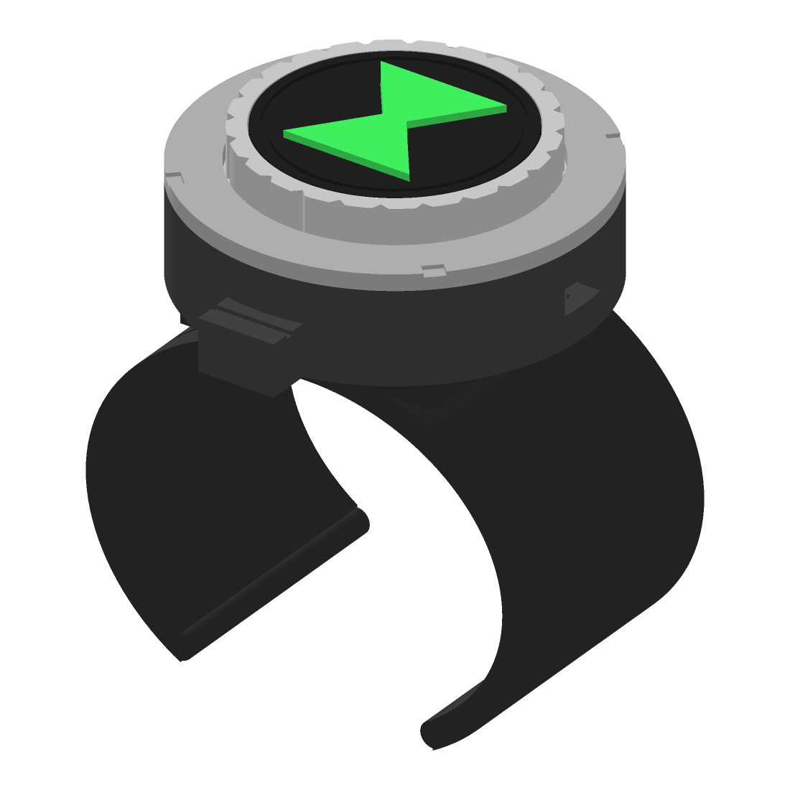
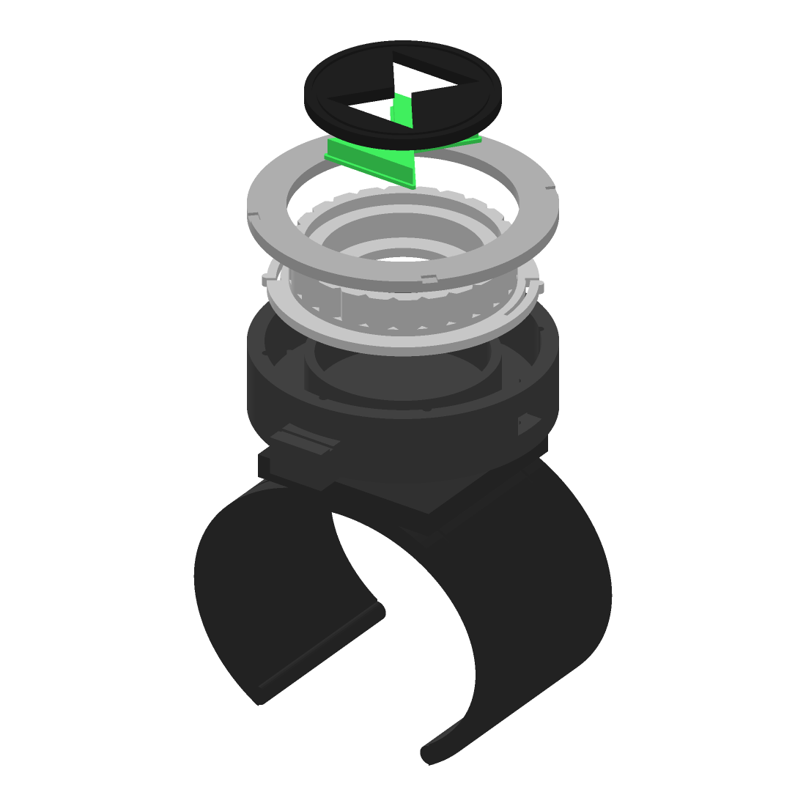

# Omnitrix-style wrist prop (fan-made, classic style)

A wearable, fan-made prop inspired by the classic Ben 10 watch, modelled from
scratch for personal use. The dial turns and clicks into 8 positions, and the
body is hollow so a green LED can be added later.




## Parts (`stl/`)

| File | Print in | Notes |
|---|---|---|
| `0_test_fit_ring.stl` | any | 10 mm slice of the cuff. Print this first (about 20 min) to check the fit. |
| `1_cuff.stl` | black / dark grey | Open C-cuff, slides on from the palm side. Print standing up (as exported). |
| `2_housing.stl` | black / dark grey | Watch body. Flat side down. |
| `3_dial.stl` | grey / silver | The turning ring. Flat flange side down. |
| `4_face.stl` | black | Face plate with the hourglass window. |
| `5_hourglass_insert.stl` | green (translucent green if you'll add an LED) | Thin lip side down. |
| `6_bezel.stl` | grey / silver | Ring that traps the dial. |
| `7_pin_x2.stl` | any | Print 2. Locate the body on the cuff. |

## Size

Cuff inside: **62 x 50 mm oval** (about 17.6 cm around), 40 mm wide band,
40 mm opening. That fits a typical adult wrist of roughly 15.5 to 17.5 cm.
To resize, change `WRIST_INNER_W` / `WRIST_INNER_H` at the top of
`generator/build.py` and run it again.

## Print settings (PLA)

- 0.2 mm layers, 3 walls, 20% infill (cuff: 4 walls, 30% so it doesn't snap)
- No supports needed for any part
- PETG is better for the cuff if you have it, since it flexes instead of cracking

## Assembly

1. Push the hourglass insert into the face from the back (lip behind the face). A drop of glue holds it.
2. Glue the face into the top of the dial.
3. Drop the dial into the housing. The two little nubs on the flange click into the grooves in the wall.
4. Glue the bezel onto the top of the housing wall (glue only on the wall, keep it off the dial). The dial should turn freely and click.
5. Push the 2 pins into the cuff's top pad, then glue the housing onto the pins and pad.

## Optional light

The housing has a 34 mm wide cavity under the dial and an 8 x 4 mm slot in the
side for a small slide switch. A CR2032 coin cell holder, one 5 mm green LED, a
100 ohm resistor and a mini slide switch fit inside. The light shines up through the
translucent green hourglass.

## Rebuilding

```
pip install manifold3d trimesh numpy matplotlib
python3 generator/build.py     # writes stl/
python3 generator/preview.py   # writes images/
```
