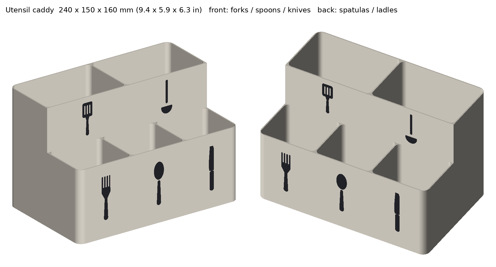

# Utensil caddy - v1



**Size:** 240 x 150 x 160 mm (9.4 x 5.9 x 6.3 in). Fits the P1S bed in one piece, no supports.

| Pocket | Inside size | Depth | For |
|---|---|---|---|
| Front left | 78 x 67 mm | 98 mm | Forks |
| Front middle | 78 x 67 mm | 98 mm | Spoons |
| Front right | 78 x 67 mm | 98 mm | Knives |
| Back left | 118 x 78 mm | 158 mm | Spatulas / turners |
| Back right | 118 x 78 mm | 158 mm | Ladles / whisks / tongs |

Cutlery (18-23 cm long) sticks out about half its length so it's easy to grab; cooking utensils (30-35 cm) stand in the 16 cm back row.

## Files
- `utensil_caddy_AMS.3mf` - one model, two parts: `body` and `icons`. In Bambu Studio give `icons` a contrasting filament (e.g. white body + black icons).
- `caddy_body.stl` + `caddy_icons.stl` - same thing as separate STLs (load both, "as single object").
- Single colour version: `../single-colour/caddy_single_colour.stl`.

## Print settings (Bambu P1S)
- PLA or PETG (PETG if it'll get wet often). 0.2 mm layers, 4 walls (the walls are 1.6 mm, so they print as solid perimeters), 15% infill (only the floor uses it).
- Print upright, as it opens. No supports, no brim needed.
- Sliced in Bambu Studio (P1S, Bambu PLA Basic): single colour about 9 h 30 min and 405 g.
- Two colours (white body, black icons): about 23.6 h and 593 g, with about 525 filament swaps, because the icons run up most of the wall height. Print the single-colour version unless you really want the icons.
- Optional: 4 x 10 mm stick-on rubber bumper feet go in the recesses under the base.

## Resize
Edit the constants at the top of `build.py` (`W`, `D`, `FRONT_H`, `BACK_H`, `BACK_SPLIT`, ...) and run:

```
pip install manifold3d trimesh numpy pillow
python build.py
python render_preview.py .
```
